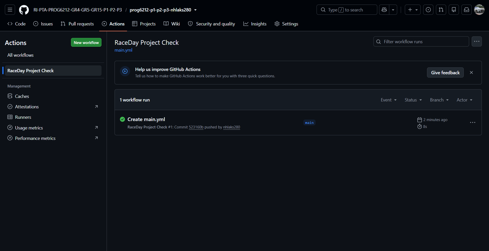

[](https://classroom.github.com/a/mr-hqvA6)

# RaceDay System

RaceDay is an event management system designed to manage running events, event categories, participant enrolments and race results.

# Part 1 – System Planning and Database

This section contains the system planning and database design for the RaceDay system.

## Documentation

- [ERD](docs/RaceDay_ERD.drawio.png)
- [API Endpoint Plan](docs/API_Endpoint_Plan.md)
- [SQL Database Script](docs/RaceDay_Database.sql)

## Database

The database design supports the relationship between organisers, participants, events, categories, enrolments and results.

The database is implemented using Microsoft SQL Server and includes:

- Users
- Events
- Categories
- Event Categories
- Enrolments
- Results

The database script includes primary keys, foreign keys, constraints and sample data.

## Roles

The system supports two user roles:

- Organiser
- Participant

Organisers are responsible for managing events, categories and participant results, while participants can enrol in events and view their results.

## GitHub Actions

The project includes a GitHub Actions workflow that checks the required Part 1 files.



## AI Use Disclosure

AI tools were used as a learning and development aid during this project. They assisted with explanations, planning, database design guidance, API endpoint planning, documentation and troubleshooting. The final project structure, files and submitted work were reviewed by the student.

## Database Validation

The RaceDay SQL script was tested using Microsoft SQL Server. The database was created successfully, the tables were created with their relationships and constraints, and the sample records were inserted successfully.

## Project Structure

```text
prog6212-p1-p2-p3-nhlaks280/
│
├── docs/
│   ├── API_Endpoint_Plan.md
│   ├── GitHub_Actions_Success.png
│   ├── RaceDay_Database.sql
│   └── RaceDay_ERD.drawio.png
│
├── .gitignore
└── README.md
```

## Database Design

The ERD and SQL database script were designed together so that the entities, primary keys, foreign keys and relationships represented in the diagram correspond with the database structure.

## Project Demonstration

[RaceDay Project Demonstration Video](https://youtu.be/8KiwUs2XoSE)

## Part 1 Status

Part 1 includes the system planning documentation, ERD, API endpoint plan, SQL database script, sample data, GitHub Actions validation and project demonstration.

---

# Part 2 – RaceDay ASP.NET Core Web API

## Project Overview

RaceDay is an event management API developed using C#, ASP.NET Core Web API, Entity Framework Core and SQL Server.

It supports user registration and login, event management, event categories, participant enrolments and race results.

## Technologies Used

- C#
- ASP.NET Core Web API
- .NET 8
- Entity Framework Core
- SQL Server LocalDB
- JWT authentication
- Swagger / OpenAPI
- xUnit automated testing
- GitHub Actions

## Main Features

- User registration and login with hashed passwords.
- JWT-based authentication and role-based authorisation.
- Create, read, update and delete operations for events.
- Event categories and enrolments.
- Race result recording and updating.
- Input validation and appropriate HTTP status codes.
- Automated tests and a GitHub Actions workflow.

## Prerequisites

- Visual Studio 2022 with the ASP.NET and web development workload.
- .NET 8 SDK.
- SQL Server LocalDB.
- Git.

## Running the API

1. Clone the repository.
2. Open `RaceDay/RaceDay.sln` in Visual Studio.
3. Restore NuGet packages.
4. Check the database connection string in `RaceDay.Api/appsettings.json`.
5. Apply Entity Framework Core migrations if required.
6. Set `RaceDay.Api` as the startup project.
7. Run the application.
8. Open the Swagger URL displayed by Visual Studio.

## Database

The application uses Entity Framework Core Code First and SQL Server LocalDB. The database schema is managed through migrations.

Current migrations:

- InitialCreate
- AddEventBannerUrl
- AddProfilePictureUrl

## Automated Testing

The test project is located in `RaceDay/RaceDay.Api.Tests`.

To run the tests from the repository root:

```bash
dotnet test RaceDay/RaceDay.sln --configuration Release
```

## Continuous Integration

GitHub Actions restores dependencies, builds the solution and runs automated tests when changes are pushed or a pull request is opened.

The workflow is located at `.github/workflows/main.yml`.

## Security Notes

Passwords are stored as hashes. Protected endpoints require JWT authentication and appropriate roles.

The JWT development key must not be reused in production. Configure secrets securely for deployment.

## AI Use Disclosure

AI assistance was used during development to explain concepts, draft code, troubleshoot issues and improve documentation. The submitted implementation should be reviewed and understood by the student.

---

# Part 3 – RaceDay ASP.NET Core MVC Application

## Project Overview

Part 3 extends the RaceDay system by introducing an ASP.NET Core MVC application that communicates with the existing Part 2 Web API.

The MVC application provides a graphical interface for organisers and participants.

## Technologies Used

- C#
- ASP.NET Core MVC
- .NET 8
- Razor Views
- Bootstrap
- Entity Framework Core
- SQL Server
- JWT authentication
- HTTP Client
- Azure Blob Storage integration
- Docker
- GitHub Actions

## Application Architecture

The RaceDay system uses a layered architecture:

- **MVC Application:** Provides the user interface.
- **Web API:** Handles application requests and business operations.
- **Database:** Stores users, events, categories, enrolments and results.
- **Azure Blob Storage:** Provides image storage through the API.

The MVC application communicates with the API through an HTTP service layer.

## Authentication and Authorisation

The application supports:

- User registration.
- User login.
- Session-based authentication.
- Organiser and Participant roles.
- Role-based access restrictions.
- Logout functionality.

## Organiser Features

The organiser interface provides functionality for:

- Organiser dashboard.
- Event listing.
- Event creation.
- Event editing.
- Event deletion.
- Event category management.
- Participant enrolment management.
- Race result management.
- Event banner image uploads.

## Participant Features

The participant interface provides functionality for:

- Viewing available events.
- Viewing event categories.
- Enrolling in events.
- Viewing personal enrolments.
- Cancelling eligible enrolments.
- Viewing race results.
- Viewing participant profiles.
- Uploading profile pictures.

## Image Uploads

Azure Blob Storage integration is implemented through the Part 2 API.

The MVC application sends image uploads to the API instead of accessing Azure Blob Storage directly.

The API provides the following upload endpoints:

- `api/ImageUploads/event-banner`
- `api/ImageUploads/profile-picture`

Supported image formats:

- JPEG
- PNG
- WEBP

The API validates uploaded images and returns the image URL.

Azure Blob Storage requires a valid connection string before uploads can operate.

## Database Changes

The application includes database migrations for:

- Event banner image URLs.
- Participant profile picture URLs.

These properties allow image URLs to be associated with their respective database records.

## Docker

The MVC project contains a Dockerfile:

`RaceDay/RaceDay.Mvc/Dockerfile`

The Docker configuration uses the .NET 8 SDK to build the application and the .NET 8 ASP.NET runtime to execute it.

Build the Docker image from the repository root:

```bash
docker build -t raceday-mvc -f RaceDay/RaceDay.Mvc/Dockerfile RaceDay/RaceDay.Mvc
```

Run the container:

```bash
docker run -d -p 8080:8080 -e ApiSettings__BaseUrl=http://host.docker.internal:5137/ --name raceday-mvc raceday-mvc
```

The API must be running and accessible on port 5137.

Open the MVC application at:

`http://localhost:8080`

## Running the Complete Solution

1. Open `RaceDay/RaceDay.sln`.
2. Restore NuGet packages.
3. Ensure SQL Server LocalDB is available.
4. Configure the API database connection string.
5. Configure Azure Blob Storage credentials when image uploads are required.
6. Start the RaceDay API.
7. Start the RaceDay MVC application.
8. Open the MVC application in a browser.

## GitHub Actions

The GitHub Actions workflow is located at:

`.github/workflows/main.yml`

It performs:

1. Repository checkout.
2. .NET 8 SDK installation.
3. Dependency restoration.
4. Solution build.
5. Automated test execution.

The solution includes:

- RaceDay.Api
- RaceDay.Api.Tests
- RaceDay.Mvc

[View RaceDay GitHub Actions](https://github.com/RI-PTA-PROG6212-GR4-GR5-GR15-P1-P2-P3/prog6212-p1-p2-p3-nhlaks280/actions)

## AI Use Disclosure

AI tools were used as a development and learning aid to assist with explanations, code development, troubleshooting and documentation.

---

# GitHub Repository

Repository:

[RaceDay GitHub Repository](https://github.com/RI-PTA-PROG6212-GR4-GR5-GR15-P1-P2-P3/prog6212-p1-p2-p3-nhlaks280)

GitHub Actions:

[RaceDay Build and Test Workflow](https://github.com/RI-PTA-PROG6212-GR4-GR5-GR15-P1-P2-P3/prog6212-p1-p2-p3-nhlaks280/actions)

The repository contains the RaceDay source code, database documentation, supporting files and development workflow.

**Submission note:** Features, integrations and deployment instructions should only be described as operational once they have been configured and verified.
