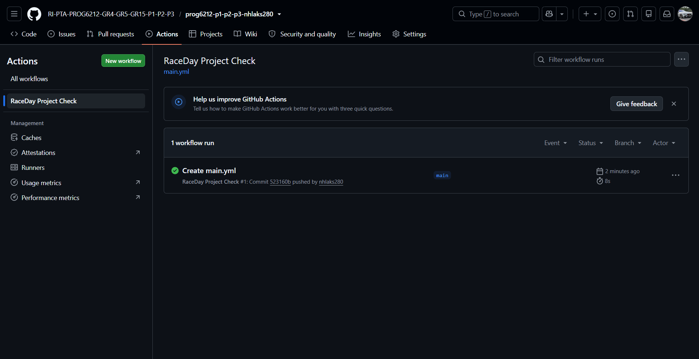

[](https://classroom.github.com/a/mr-hqvA6)
## RaceDay System

RaceDay is an event management system designed to manage running events, event categories, participant enrolments and race results.

### Part 1 – System Planning and Database

This section contains the system planning and database design for the RaceDay system.

### Documentation

- [ERD](docs/RaceDay_ERD.drawio.png)
- [API Endpoint Plan](docs/API_Endpoint_Plan.md)
- [SQL Database Script](docs/RaceDay_Database.sql)

### Database

The database design supports the relationship between organisers, participants, events, categories, enrolments and results.
The database is implemented using Microsoft SQL Server and includes:

- Users
- Events
- Categories
- Event Categories
- Enrolments
- Results

The database script includes primary keys, foreign keys, constraints and sample data.

### Roles

Organisers are responsible for managing events, categories and participant results, while participants can enrol in events and view their results.
The system supports two user roles:

- Organiser
- Participant


### GitHub Actions

The project includes a GitHub Actions workflow that checks that all required Part 1 files are present.




### AI Use Disclosure

AI tools were used as a learning and development aid during this project. They assisted with explanations, planning, database design guidance, API endpoint planning, documentation and troubleshooting. The final project structure, files and submitted work were reviewed and understood by the student.


### Database Validation

The RaceDay SQL script was tested using Microsoft SQL Server. The database was created successfully, the tables were created with their relationships and constraints, and the sample records were inserted successfully.


### Project Structure

prog6212-p1-p2-p3-nhlaks280/

 docs/
    API_Endpoint_Plan.md
    GitHub_Actions_Success.png
    RaceDay_Database.sql
    RaceDay_ERD.drawio.png

 .gitignore
 README.md

 ### Database Design

The ERD and SQL database script were designed together so that the entities, primary keys, foreign keys and relationships represented in the diagram correspond with the database structure.


 ### Project Demonstration

[RaceDay Project Demonstration Video](https://youtu.be/8KiwUs2XoSE)


### Part 1 Status

Part 1 includes the system planning documentation, ERD, API endpoint plan, SQL database script, sample data, GitHub Actions validation and project demonstration.


## Part 2: RaceDay ASP.NET Core Web API

### Project Overview

RaceDay is an event management API developed using C#, ASP.NET Core Web API, Entity Framework Core, and SQL Server. It supports user registration and login, event management, event categories, participant enrolments, and race results.

### Technologies Used

- C#
- ASP.NET Core Web API
- .NET 8
- Entity Framework Core
- SQL Server LocalDB
- JWT authentication
- Swagger / OpenAPI
- xUnit automated testing
- GitHub Actions

### Main Features

- User registration and login with hashed passwords.
- JWT-based authentication and role-based authorization.
- Create, read, update, and delete operations for events.
- Event categories and enrolments.
- Race result recording and updating.
- Input validation and appropriate HTTP status codes.
- Automated tests and a GitHub Actions workflow.

### Prerequisites

Install the following software:

- Visual Studio 2022 with the ASP.NET and web development workload.
- .NET 8 SDK.
- SQL Server LocalDB.
- Git.

### Running the Application

1. Clone the repository.
2. Open `RaceDay/RaceDay.sln` in Visual Studio.
3. Restore NuGet packages.
4. Check the database connection string in `RaceDay/RaceDay.Api/appsettings.json`.
5. Apply the Entity Framework Core migrations to create or update the database.
6. Set `RaceDay.Api` as the startup project.
7. Run the application.
8. Open the Swagger URL displayed by Visual Studio.

### Database

The application uses Entity Framework Core Code First and SQL Server LocalDB. The database schema is managed through migrations.

### Automated Testing

The test project is located in `RaceDay/RaceDay.Api.Tests`.

To run the tests from the repository root:

```bash
dotnet test RaceDay/RaceDay.sln --configuration Release
```

### Continuous Integration

GitHub Actions automatically restores dependencies, builds the solution, and runs the automated tests when changes are pushed or a pull request is opened.

The workflow is located at `.github/workflows/main.yml`.

### Security Notes

Passwords are stored as hashes. Protected endpoints require JWT authentication and appropriate roles. The JWT development key must not be reused in production; configure secrets securely for deployment.

### AI Use Disclosure

AI assistance was used during development to help explain concepts, draft code, troubleshoot errors, and improve documentation. The submitted implementation should be reviewed and understood by the student.
```

**Important:** The instructions above describe the intended setup. Before submission, confirm the migration commands and project paths match your actual solution.

## Final checks

After saving the README:

1. Commit and push your changes.
2. Confirm the new GitHub Actions run is green.
3. Check that the repository contains the API, test project, workflow, database documentation, and README.
4. Ensure your required demonstration video and any submission-specific evidence are ready.

One security task remains important: because the repository is public, make sure your JWT signing key is a development-only value and move secrets out of committed configuration before any real deployment.

